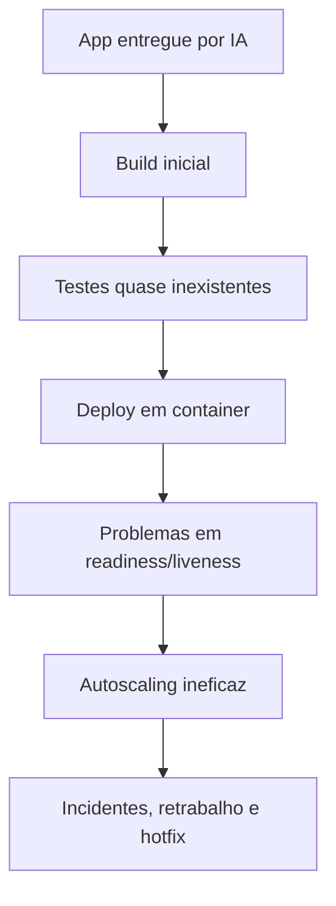
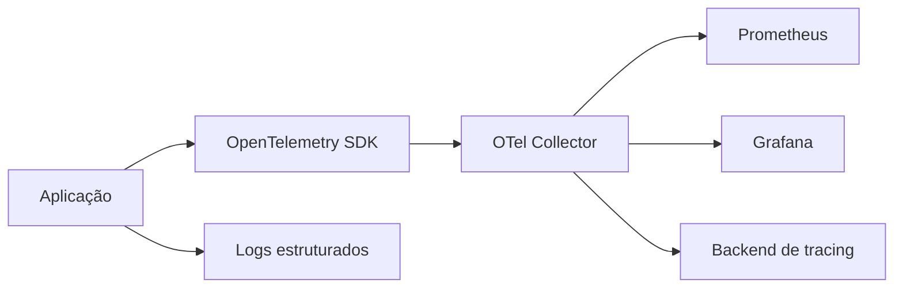
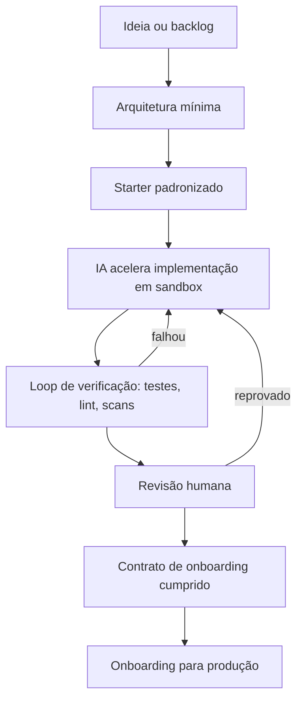

Quando uma aplicação é escrita quase toda por IA, por um time que não tem base sólida de engenharia de software, colocá-la em produção deixa de ser uma questão de pipeline e vira um trabalho de contenção de risco. Este texto é sobre isso: o que chega para o time de DevSecOps, por que chega desse jeito e o que dá para fazer antes.

<!--more-->

> **Sobre a base deste artigo.** O texto parte da minha experiência no dia a dia, mas a espinha dorsal teórica vem do survey [*AI Agent Systems: Architectures, Applications, and Evaluation*](https://arxiv.org/html/2601.01743v1), de Bin Xu (Arizona State University, arXiv:2601.01743, 2026). Sempre que eu citar "o survey" ou "Xu (2026)" ao longo do texto, é dele que estou falando. As ideias de verificação, avaliação, autonomia proporcional ao risco e contratos de ferramenta que aparecem aqui foram tiradas desse trabalho e adaptadas para a realidade de quem opera software em produção.

## Por que escrevi isso

Desenvolvimento assistido por IA já faz parte da rotina de quase todo time. Geração de código, testes, refatoração, manifests, Terraform, documentação: tudo isso passa por alguma ferramenta de IA hoje em dia. E eu não tenho nada contra. Uso bastante, inclusive.

O que mudou recentemente é que boa parte desse código não vem mais de um autocomplete, e sim de **agentes**. Xu (2026) define agentes como sistemas que juntam um modelo de fundação com raciocínio, planejamento, memória e uso de ferramentas. Traduzindo: o agente lê o repositório, edita arquivo, roda comando, instala dependência e gera manifest, tudo num loop que pode dar dezenas de voltas sem ninguém olhando cada passo.

Em time experiente, isso é ganho de escala de verdade. O problema começa quando a velocidade de geração passa a ser tratada como se fosse maturidade de engenharia.

A pergunta que aparece na prática não é "a IA falhou"; é: "como a gente leva isso para produção sem virar uma operação de emergência?" Ao longo da minha experiência com DevOps e SRE, e em conversas com quem vive o mesmo dia a dia, esse cenário aparece com frequência: chega uma aplicação que "funciona" localmente e, olhando com um pouco de cuidado, está longe de aguentar produção. O que deveria ser uma entrada simples no pipeline vira análise de arquitetura, de operação, de segurança e de observabilidade. Chega um conjunto de arquivos com cara de software e comportamento de protótipo.

Não estou escrevendo para reclamar do uso de IA. Estou escrevendo porque a conversa precisa sair do campo da promessa e entrar no da operação real. O objetivo aqui é simples: mostrar um caminho útil para receber essas aplicações com menos risco, menos retrabalho e mais clareza sobre o que precisa ser validado antes de qualquer deploy.

## O que o survey de Xu (2026) diz sobre isso

Quando li o survey pela primeira vez, a sensação foi de que alguém tinha escrito, com linguagem acadêmica, o que a gente sente operando essas aplicações. O trabalho não é sobre DevSecOps. É uma revisão ampla de como agentes de IA são construídos, treinados e avaliados. Mas três pontos dele caem como uma luva no nosso problema.

O primeiro está na parte sobre agentes de código e manutenção de software. O autor diz que as tarefas reais de software são longas, dependem de muitas ferramentas e que as falhas costumam ser **sutis e tardias**: regressões de segurança, comportamento que muda escondido atrás de feature flag, defeitos que só aparecem em teste de integração ou sob carga parecida com a de produção. Ou seja, o erro não aparece na máquina de quem gerou o código. Aparece quando a aplicação chega pra gente.

O segundo vem logo em seguida: *"plausible patches are not enough"*. Um patch plausível não basta, é preciso correção de ponta a ponta e o mínimo de regressão. Uma API que compila e responde na porta 3000 é exatamente isso, um patch plausível.

O terceiro está na conclusão, e é talvez a frase que mais resume este artigo: *"reliability and governance are properties of the full stack"*. Confiabilidade e governança são propriedades da stack inteira, não do modelo. Não adianta usar o modelo mais caro do mercado se não existe revisão, teste, pipeline, observabilidade e controle de permissão em volta dele.

O survey fecha falando da distância entre demonstrações impressionantes e implantação robusta no mundo real. Pra quem trabalha com plataforma, essa distância tem nome: backlog.

## "Funciona" não é critério de pronto

Uma parte do survey que eu gosto muito é a de avaliação. O autor argumenta que medir agente só pela taxa de sucesso é pouco, e propõe olhar várias dimensões ao mesmo tempo: desempenho fim a fim, custo e latência, se as ferramentas foram usadas corretamente, robustez sob perturbação, segurança ao longo da execução. Tem até uma observação ótima de que agentes podem "resolver" tarefas sendo lentos ou caros demais para uso real.

Trocando "agente" por "aplicação", vira um checklist de onboarding. "Funciona" é a taxa de sucesso. O resto é o que a gente precisa perguntar:

- Funciona num ambiente parecido com produção, ou só no localhost?
- Qual a latência p95 e quanto de CPU e memória ela consome sob carga de verdade?
- As integrações com banco, fila e APIs externas tratam timeout, erro e retry?
- O que acontece quando uma dependência fica instável, o pod reinicia ou o tráfego dobra?
- Tem segredo exposto, dado vazando ou ação sem autorização em algum ponto do fluxo?
- Se der incidente amanhã, dá para reconstruir o que aconteceu com os logs, métricas e traces que existem?

Xu (2026) insiste que a segurança tem que ser avaliada ao longo de toda a trajetória de execução, e não só na resposta final. Pra aplicação vale igual: o `200 OK` no fim da requisição não diz nada sobre o que aconteceu no caminho.

## O que costuma chegar

Raramente o onboarding de uma aplicação gerada quase toda por IA começa com uma arquitetura limpa e um plano de operação. O que chega é um monte de sinais de que o software foi construído em cima da pergunta "como faço isso funcionar?", e nunca da pergunta "como isso sobrevive em produção?".

A boa notícia é que isso não precisa virar uma crítica sem saída. O ponto central é simples: o problema não é a IA em si, e sim a falta de uma etapa de validação e de governança antes do serviço entrar em produção. Quando a equipe trata isso como uma etapa de disciplina operacional — e não como uma "queixa de plataforma" — a solução fica muito mais clara.

Os sinais mais comuns, pela minha experiência, são:

- **Repositório sem estrutura definida.** Só pra entender o fluxo e onde estão os pontos de falha já vai um bom tempo.
- **Teste inexistente ou superficial.** Sem isso não tem CI confiável, nem rollback seguro.
- **Teste gerado só pra passar.** Esse é pior que o anterior, porque dá falsa sensação de segurança. Cobertura alta, assert fraco.
- **Dockerfile improvisado.** Imagem enorme, lenta, difícil de auditar.
- **Configuração e segredo no meio do código.**
- **Manifest de Kubernetes genérico,** sem probe, sem resource, sem estratégia de rollout.
- **Log em texto solto,** impossível de correlacionar.
- **Dependência desatualizada, ou que ninguém sabe de onde veio.**
- **Nenhum registro de como o código foi gerado.** Não dá pra saber o que foi decisão do agente e o que alguém de fato revisou.

Muitas vezes, o primeiro trabalho não é fazer deploy. É descobrir se aquilo pode virar algo operável sem reescrever do zero. E, para isso, a abordagem mais útil é bem direta: validar a aplicação como se ela já estivesse em produção, antes de tratá-la como produto pronto.

### Uma abordagem útil para o time

Em vez de tratar o app gerado por IA como uma entrega acabada, vale pensar em cinco critérios simples:

1. **O sistema roda em ambiente parecido com produção?**
2. **Ele tem testes mínimos que falham quando a regra quebra?**
3. **Tem saúde, logs e métricas suficientes para diagnosticar problema?**
4. **Os segredos e permissões estão controlados?**
5. **A operação foi pensada antes do primeiro deploy?**

Se a resposta para qualquer um desses pontos for "não", a próxima etapa não é reclamar — é fechar o gap com a menor mudança possível, de modo que o serviço fique seguro, observável e sustentável.

## Arquitetura

O primeiro problema quase sempre é arquitetural. Aplicação gerada sem direção tende a seguir o caminho de menor resistência: um monólito grande, regra de negócio misturada com tudo, sem fronteira de domínio.

O survey ajuda a entender por quê. Xu (2026) descreve o funcionamento de um agente como um ciclo: observa, busca contexto, propõe uma ação, valida, executa e atualiza a memória. Se ninguém dá uma arquitetura-alvo como contexto, cada volta desse ciclo resolve o problema da vez do jeito mais direto possível. O sistema final é montado por acúmulo, não por desenho. E o autor lembra que, em tarefas longas, os erros se acumulam (*compounding errors*): uma decisão ruim no passo 3 vira premissa para tudo que vem depois.

Vale dizer: monólito não é problema por si só. O problema é o monólito sem modularização nenhuma, onde autenticação, regra de negócio, persistência, integração e apresentação vivem no mesmo fluxo. Aí qualquer mudança pequena quebra algo que parecia não ter relação nenhuma. É comum ver um único serviço que recebe a requisição, valida, consulta o banco, chama API externa, monta a resposta, grava auditoria e ainda implementa retry na mão. Função gigante, opaca e frágil.

SOLID some. Padrões simples que ajudariam muito (Repository, Adapter, Strategy, Circuit Breaker, Outbox, Bulkhead) não aparecem. E não falo isso por apego a pattern, mas porque sem essa linguagem estrutural o sistema não tem como crescer de forma organizada.

Duplicação de código também é frequente. Com agente, ela é ainda mais comum, porque o contexto de cada sessão é limitado: o agente não "lembra" que já existe um utilitário igual em outro módulo e escreve outro. Somam-se a isso as dependências circulares, que aparecem porque o código foi organizado por proximidade funcional e não por arquitetura. O build sofre, a refatoração fica cara e o grafo de dependências vira um novelo.

## System design

Se a arquitetura mostra a forma do problema, o system design mostra o estrago na operação.

Aplicação gerada sem pensamento de sistema costuma assumir carga constante, latência estável e dependências sempre disponíveis. Nada disso existe em produção. Os pontos que mais vejo:

**Estado em memória e sessão local.** Funciona até o primeiro restart, reschedule ou scale-out. Depois disso, usuário deslogado e dado perdido.

**Nenhum cache.** Toda leitura vai direto ao banco, que vira ponto único de verdade e de gargalo. A gente acaba olhando métrica de pool de conexão e saturação sem ter nenhuma camada intermediária pra aliviar.

**Tudo síncrono.** Uma chamada depende da outra, que depende de uma terceira. A latência se soma, o timeout aparece e uma falha derruba a cadeia inteira. Fila resolveria boa parte disso, mas não tem.

**Sem idempotência, sem tolerância a falha.** Sem idempotência, retry vira risco de operação duplicada. Sem tolerância a falha, uma API externa fora do ar derruba o fluxo todo.

Um sistema bom não é o que nunca falha. É o que falha de um jeito previsível, que dá pra detectar e do qual dá pra se recuperar.

## Cloud e Kubernetes

Aqui é onde o onboarding dói de verdade. Muita aplicação gerada por IA foi pensada para rodar, não para ser operada num orquestrador. É bem o cenário descrito no survey: problemas que só aparecem sob carga parecida com a de produção.

Kubernetes pressupõe um contrato mínimo com a aplicação. Ela precisa dizer quando está viva, quando está pronta pra receber tráfego, como encerra e como lida com estado. Se o código não oferece isso, a plataforma vira uma camada de compensação.

Sem `readinessProbe`, o tráfego chega antes da aplicação estar pronta. Sem `livenessProbe`, um processo travado fica lá ocupando o pod. Sem `startupProbe`, aplicação que demora pra subir é morta antes de terminar de iniciar. E tem um clássico do código gerado: o `/health` que retorna `200` sempre, sem checar nada. Ele satisfaz o manifest e não informa coisa nenhuma ao cluster.

Graceful shutdown é outro ponto. Muita aplicação ignora o `SIGTERM`: não fecha conexão, não drena requisição, não termina a transação. Em todo rollout, alguém perde uma requisição.

Escalar horizontalmente também não é só aumentar réplica. Se o estado está em memória, o autoscaling quebra a experiência do usuário. E sem `requests` e `limits` o scheduler trabalha no escuro, o HPA escala no momento errado e ninguém entende por quê.

Por fim, configuração misturada com código transforma deploy em intervenção manual, e storage persistente usado sem necessidade complica qualquer tentativa de resiliência.



## DevSecOps

Do lado de DevSecOps, o mais caro nem é achar vulnerabilidade. É não ter base nenhuma para automatizar o controle de qualidade.

Sem padrão de branch, estrutura e build, cada aplicação pede um pipeline praticamente artesanal. Sem teste, o pipeline deixa de ser mecanismo de confiança. CI não existe pra "passar", existe pra provar que a mudança não quebrou o que já funcionava.

E tem uma armadilha bem específica de código gerado: quando o mesmo agente escreve o código e o teste, o teste confirma o que o código faz, não o que ele deveria fazer. Por isso Xu (2026), ao falar de agentes de engenharia de software, diz que é essencial reportar a validade do patch e o comportamento de regressão, e não só se a tarefa passou. Cobertura alta com assert fraco me preocupa mais do que cobertura baixa honesta.

### Dockerfile

Build lento reduz feedback. Imagem grande custa mais pra baixar, escalar e corrigir. Normalmente o Dockerfile que chega é algo assim:

```dockerfile
FROM node:18
WORKDIR /app
COPY . .
RUN npm install
EXPOSE 3000
CMD ["npm", "start"]
```

E uma versão razoável seria:

```dockerfile
FROM node:20-alpine AS deps
WORKDIR /app
COPY package*.json ./
RUN npm ci --omit=dev

FROM node:20-alpine AS runner
WORKDIR /app
ENV NODE_ENV=production
COPY --from=deps --chown=node:node /app/node_modules ./node_modules
COPY --chown=node:node . .
USER node
EXPOSE 3000
CMD ["node", "server.js"]
```

Não esqueça do `.dockerignore`, com pelo menos `node_modules`, `.git`, `.env*` e artefatos de teste. Sem ele, o `COPY . .` sobrescreve as dependências do estágio anterior e ainda pode levar segredo local pra dentro da imagem.

### Segredos no código

É um dos sinais mais perigosos. Quando aparece segredo no repositório, o problema já se espalhou: tem que rotacionar, revogar, auditar e torcer pra não ter vazado.

Com agente, isso piora. A sessão do agente normalmente tem acesso ao `.env` local, ao histórico do shell e às credenciais de quem está rodando. Se nada impedir, essas informações vão parar em arquivo de configuração, exemplo de código ou até em mensagem de commit.

### O agente também é superfície de ataque

Esse ponto quase nunca entra na conversa, e foi lendo o survey que eu passei a olhar pra ele com mais atenção. Um agente de código executa comando, instala pacote e altera arquivo. Ele faz parte da cadeia de suprimentos do software, quer a gente goste ou não.

Xu (2026) levanta alguns riscos que valem para qualquer empresa que deixa agentes mexerem em repositório:

- **Prompt injection.** Conteúdo não confiável (issue, ticket, documentação externa, README de dependência) pode carregar instruções que o agente segue.
- **Ações sem volta.** Migration, `terraform apply`, `kubectl delete`. O survey recomenda *permission gates*, ou seja, uma aprovação explícita antes de qualquer ação irreversível.
- **Memória envenenada.** Se o agente mantém memória entre sessões, conteúdo malicioso vindo de uma ferramenta pode persistir.
- **Permissão demais.** O autor defende permissões limitadas por papel, allowlist de ferramentas e execução em sandbox, para que um erro não se espalhe.

Na prática, eu trato o agente como mais um ator do pipeline: identidade própria, token com escopo mínimo, execução isolada e log auditável. Se o time não consegue responder "quais comandos o agente rodou e com qual credencial?", o problema de supply chain começou antes do primeiro build.

### Ferramentas de segurança no pipeline

Ferramenta não conserta arquitetura ruim, mas ajuda a não deixar passar o óbvio. O mínimo que costumo colocar:

- **SAST** para padrões inseguros no código;
- **SCA** para dependências vulneráveis. Em código gerado, confira também se o pacote existe mesmo e é o certo, porque modelo às vezes sugere nome parecido com biblioteca legítima;
- **Secret scanning** para chaves e tokens;
- **Container scanning** para a imagem;
- **IaC scanning** para Terraform, Helm e manifests;
- **SBOM** para saber o que de fato está dentro do software.

Um exemplo de pipeline no GitLab CI:

```yaml
stages:
  - test
  - sast
  - sca
  - build
  - container_scan
  - deploy

variables:
  IMAGE: $CI_REGISTRY_IMAGE:$CI_COMMIT_SHA

unit_tests:
  stage: test
  image: node:20
  script:
    - npm ci
    - npm test -- --coverage

semgrep_sast:
  stage: sast
  image: semgrep/semgrep
  script:
    - semgrep scan --config p/owasp-top-ten --json --output semgrep.json

owasp_dependency_check:
  stage: sca
  image: owasp/dependency-check:latest
  script:
    - dependency-check.sh --scan . --format JSON --out dependency-check

build_image:
  stage: build
  image: docker:27
  services:
    - docker:27-dind
  script:
    - docker login -u "$CI_REGISTRY_USER" -p "$CI_REGISTRY_PASSWORD" "$CI_REGISTRY"
    - docker build -t "$IMAGE" .
    - docker push "$IMAGE"

trivy_container:
  stage: container_scan
  image: aquasec/trivy:latest
  script:
    - trivy fs --severity HIGH,CRITICAL --exit-code 1 .
    - trivy image --severity HIGH,CRITICAL --exit-code 1 "$IMAGE"
```

O equivalente no GitHub Actions:

```yaml
name: security-pipeline

on:
  push:
    branches: ["main"]

permissions:
  contents: read

jobs:
  scan:
    runs-on: ubuntu-latest
    steps:
      - uses: actions/checkout@v4
      - uses: actions/setup-node@v4
        with:
          node-version: 20
      - run: npm ci
      - run: npm test -- --coverage
      - uses: aquasecurity/trivy-action@0.28.0
        with:
          scan-type: fs
          severity: HIGH,CRITICAL
          exit-code: 1
```

Repare no `permissions: contents: read`. O token do workflow recebe só o que precisa. É o mesmo princípio de menor privilégio que vale para o agente.

Se usar SonarQube, o quality gate bloqueando o merge já ajuda bastante:

```properties
sonar.projectKey=app-gerada-por-ia
sonar.sources=src
sonar.tests=test
sonar.javascript.lcov.reportPaths=coverage/lcov.info
sonar.qualitygate.wait=true
```

E pra rodar localmente antes do push:

```bash
semgrep scan --config p/security-audit --config p/owasp-top-ten src/
trivy fs --scanners vuln,secret,misconfig .
```

## Observabilidade

Observabilidade tem que nascer junto com a aplicação. Nas apps que recebo, geralmente o cenário é log espalhado, métrica inexistente e tracing só no slide da apresentação.

O survey trata logs de chamadas de ferramenta, artefatos intermediários e traces como saídas de primeira classe, tão importantes quanto o resultado final, porque sem eles não tem depuração, conformidade nem reprodutibilidade. Achei curioso ver isso num trabalho sobre agentes, porque é exatamente o argumento que a gente usa com aplicação: se não dá pra reconstruir o que aconteceu, não dá pra operar.

Log em texto livre ajuda no começo e atrapalha no primeiro incidente sério. Sem estrutura, não tem como correlacionar por `trace_id`, `request_id`, usuário ou serviço. Sem métrica, ninguém enxerga latência, erro, throughput ou saturação. Prometheus e Grafana não são enfeite, fazem parte do contrato operacional. E em sistema distribuído, tracing é o único jeito prático de seguir uma requisição entre serviços. Hoje o caminho mais simples pra isso é OpenTelemetry:

```yaml
env:
  - name: OTEL_SERVICE_NAME
    value: app-gerada-por-ia
  - name: OTEL_EXPORTER_OTLP_ENDPOINT
    value: http://otel-collector:4317
  - name: OTEL_RESOURCE_ATTRIBUTES
    value: service.namespace=platform,deployment.environment=prod
```



## Segurança da aplicação

Quando a aplicação é feita sem revisão séria, a segurança é a primeira a sentir.

JWT validado pela metade é muito comum: assinatura ignorada, expiração mal tratada, `aud` inexistente, refresh token sem proteção. Autenticação sem autorização também: a aplicação sabe quem é o usuário, mas não checa o que ele pode fazer.

Além disso, a lista de sempre aparece com frequência: SQL injection por concatenação de string, XSS, SSRF por aceitar qualquer URL, upload sem validação de tipo e tamanho, CORS liberado pra tudo, nenhum rate limiting e dependências com CVE conhecida.

Nada disso é detalhe. É o resultado de um projeto feito sem modelo mental de segurança. E é exatamente o tipo de regressão que, como lembra Xu (2026), passa despercebida até chegar perto de produção.

Um Deployment com o mínimo que eu espero ver:

```yaml
apiVersion: apps/v1
kind: Deployment
metadata:
  name: app-gerada-por-ia
spec:
  replicas: 3
  selector:
    matchLabels:
      app: app-gerada-por-ia
  template:
    metadata:
      labels:
        app: app-gerada-por-ia
    spec:
      terminationGracePeriodSeconds: 30
      securityContext:
        runAsNonRoot: true
      containers:
        - name: app
          image: registry.example/app:1.0.0
          ports:
            - containerPort: 3000
          securityContext:
            allowPrivilegeEscalation: false
            readOnlyRootFilesystem: true
            capabilities:
              drop: ["ALL"]
          resources:
            requests:
              cpu: "100m"
              memory: "128Mi"
            limits:
              cpu: "500m"
              memory: "256Mi"
          startupProbe:
            httpGet:
              path: /health
              port: 3000
            failureThreshold: 30
            periodSeconds: 2
          readinessProbe:
            httpGet:
              path: /ready
              port: 3000
            periodSeconds: 5
          livenessProbe:
            httpGet:
              path: /health
              port: 3000
            periodSeconds: 10
          lifecycle:
            preStop:
              exec:
                command: ["sh", "-c", "sleep 10"]
```

E a base de infraestrutura versionada desde o início, mesmo que seja só o namespace:

```hcl
terraform {
  required_version = ">= 1.6.0"
}

resource "kubernetes_namespace" "app" {
  metadata {
    name = "app-gerada-por-ia"
    labels = {
      owner = "platform"
      tier  = "prod"
    }
  }
}
```

## O impacto na operação

Quando uma aplicação chega nesse estado, o problema deixa de ser só técnico e passa a ser organizacional.

Cada incidente exige ler código, mexer em infraestrutura, corrigir build e, muitas vezes, fazer alguma intervenção manual. O time de plataforma para de operar um sistema e passa a sustentar um protótipo em produção. Sem teste, contrato e observabilidade, toda mudança vira risco, e o time de produto começa a depender de janela de manutenção e hotfix.

O diagnóstico também fica mais lento. Sem log estruturado, trace e métrica útil, o tempo pra achar a causa raiz cresce e a gente acaba investigando sintoma. Pior ainda quando ninguém no time de produto conhece o código a fundo, porque ninguém escreveu de fato.

O pipeline sofre junto. Ele precisa compensar a falta de padrão, bloquear segredo, achar vulnerabilidade, validar build e segurar regressão. Vira algo complexo, caro e, não raramente, questionado por quem gerou o código.

E tem o custo que não aparece. O survey chama atenção para custos escondidos que a taxa de sucesso não mostra: retentativas, crescimento de contexto, tempo e intervenção humana. No onboarding é igual. A velocidade de geração aparece no relatório do time de produto. As horas de triagem, retrabalho e hotfix aparecem no backlog de outro time. Se a empresa só olha o primeiro número, vai sempre achar que a IA está saindo de graça.

## A dívida técnica que vem junto

Dívida técnica não é código feio. É uma conta que cresce quando se escolhe velocidade sem controle, e com IA mal usada ela cresce em várias frentes ao mesmo tempo. Tem a dívida de arquitetura, de um sistema que nasce sem fronteiras e fica caro de modularizar depois. Tem a operacional, por falta de sinais e contratos para operar. Tem a de segurança, com vulnerabilidade que entra cedo e se espalha. E tem a de plataforma, com o time de DevSecOps criando exceção e remendo sob pressão.

Tem também uma que eu acho mais silenciosa: a dívida de conhecimento. Quando boa parte do código foi escrita por um agente e aceita sem revisão profunda, ninguém no time tem o modelo mental completo do sistema. O problema não está só no código, está na falta de gente capaz de explicá-lo.

E como a IA acelera a criação dessa dívida, no curto prazo ela parece produtividade.

## Como evitar

Evitar esse cenário não passa por proibir IA. Passa por colocar engenharia antes da automação. Uma coisa que me chamou atenção lendo o survey é que as recomendações que Xu (2026) faz para tornar *agentes* confiáveis são praticamente as mesmas que a gente faz para tornar *aplicações* confiáveis.

**Defina um baseline de arquitetura antes de gerar código.** Fronteiras do sistema, modelo de estado, contratos de integração, padrão de persistência. E coloque isso como contexto para o agente, em arquivos de instrução no próprio repositório, em vez de deixar só na cabeça de quem desenhou.

**Ofereça templates e starters oficiais.** Skeleton de projeto, pipeline padrão, observabilidade já configurada, policy-as-code. Pro agente, um bom starter funciona como as interfaces estruturadas que o survey recomenda: limita o espaço de ação e reduz a chance de ele sair inventando.

**Exija verificação, não só geração.** O padrão que o survey propõe para agentes de código é um loop explícito: roda teste e linter, analisa a falha, corrige e repete até passar, sempre com base em diagnóstico concreto. No processo do time, isso significa CI bloqueando código sem validação mínima e alguém que entende a regra de negócio revisando os testes.

**Coloque segurança desde o primeiro commit.** SAST, SCA, secret scanning, container e IaC scanning, SBOM. No fluxo padrão, não numa etapa no fim.

**Dê ao agente o mínimo de privilégio.** Sandbox, token com escopo reduzido, allowlist de ferramentas e aprovação humana para ação irreversível. O survey chama isso de *budgeted autonomy*, que eu traduziria como autonomia proporcional ao risco: quanto maior o impacto e menor a chance de desfazer, mais verificação antes de executar. Gerar um teste unitário pode ser autônomo. Mudar uma policy de IAM, não.

**Projete para operar.** Sem health check, sem shutdown decente, com estado em memória e sem plano de escala, a aplicação não está pronta, ponto.

Para formalizar esse último item, eu me inspirei na ideia de *tool contracts* do survey, em que cada ferramenta do agente tem pré-condições, pós-condições e evidência para auditoria. Aplicado ao nosso caso, vira um **contrato de onboarding**, um checklist que a aplicação precisa cumprir antes de entrar no pipeline de produção:

- [ ] Testes automatizados com asserts que fazem sentido, e os críticos revisados por alguém
- [ ] Probes de startup, readiness e liveness que checam dependências de verdade
- [ ] Tratamento de `SIGTERM` testado num rollout
- [ ] Configuração em ConfigMap e Secret, nenhum segredo no repositório
- [ ] Logs estruturados, métricas e traces com `trace_id` correlacionável
- [ ] Imagem multi-stage, rodando como não-root, sem vulnerabilidade HIGH/CRITICAL
- [ ] SBOM gerado e SCA aprovado
- [ ] Registro de quais partes foram geradas por IA e de quem revisou

Por último, **IA é copiloto, não arquiteto.** Ela sugere, acelera e padroniza, mas design, trade-off e operação continuam sendo responsabilidade de gente. Até o survey, escrito por quem constrói agentes, deixa as decisões de alto impacto com humanos e trata a taxa de intervenção humana como uma métrica a ser reportada, não como algo a esconder.



## Para fechar

Time de DevSecOps não existe pra dizer "não". Existe pra fazer software ir pra produção de forma segura, observável e sustentável.

Quando chega uma aplicação gerada quase toda por IA sem base de engenharia, o que a gente encontra não são só bugs. É falta de pensamento de sistema, de disciplina de arquitetura e de preocupação com operação. Por isso a conversa certa não é sobre culpar a IA, e sim sobre responsabilidade técnica. A IA acelera o trabalho bom e acelera o erro na mesma medida, e quem decide qual dos dois sai é quem está conduzindo.

O survey de Xu (2026) chega à mesma conclusão por outro caminho: confiabilidade e governança são da stack inteira, não do modelo. No fim, a diferença entre protótipo e software de produção continua sendo engenharia. Quando ela existe, a IA multiplica a capacidade do time. Quando não existe, o problema só fica mais rápido de criar e mais caro de corrigir.

Uma aplicação que funciona não é necessariamente uma aplicação pronta para produção.

Se você quiser se aprofundar na parte de agentes, recomendo muito a leitura do [survey completo](https://arxiv.org/html/2601.01743v1). Ele vai bem além do que trouxe aqui, principalmente na parte de avaliação e nos desafios em aberto.

## Referências

**Referência principal**

- XU, Bin. **AI Agent Systems: Architectures, Applications, and Evaluation**. arXiv:2601.01743, 2026. Disponível em: [https://arxiv.org/html/2601.01743v1](https://arxiv.org/html/2601.01743v1)

**Documentação técnica usada nos exemplos**

- [Kubernetes Documentation](https://kubernetes.io/docs/)
- [Kubernetes: Configure Liveness, Readiness and Startup Probes](https://kubernetes.io/docs/tasks/configure-pod-container/configure-liveness-readiness-startup-probes/)
- [Kubernetes: Configure a Security Context for a Pod or Container](https://kubernetes.io/docs/tasks/configure-pod-container/security-context/)
- [Kubernetes: Define a Command and Arguments for a Container](https://kubernetes.io/docs/tasks/inject-data-application/define-command-argument-container/)
- [OpenTelemetry Documentation](https://opentelemetry.io/docs/)
- [Prometheus Documentation](https://prometheus.io/docs/introduction/overview/)
- [Grafana Documentation](https://grafana.com/docs/)
- [OWASP Top 10](https://owasp.org/www-project-top-ten/)
- [OWASP Cheat Sheet Series](https://cheatsheetseries.owasp.org/)
- [OWASP Dependency-Check](https://owasp.org/www-project-dependency-check/)
- [Semgrep Documentation](https://semgrep.dev/docs/)
- [Trivy Documentation](https://trivy.dev/)
- [GitLab CI/CD Documentation](https://docs.gitlab.com/ee/ci/)
- [GitHub Actions Documentation](https://docs.github.com/actions)
- [GitHub Actions: Controlling permissions for GITHUB_TOKEN](https://docs.github.com/actions/writing-workflows/choosing-what-your-workflow-does/controlling-permissions-for-github_token)
- [Dockerfile reference](https://docs.docker.com/reference/dockerfile/)
- [SonarQube Documentation](https://docs.sonarsource.com/sonarqube/)
- [Terraform Documentation](https://developer.hashicorp.com/terraform/docs)
